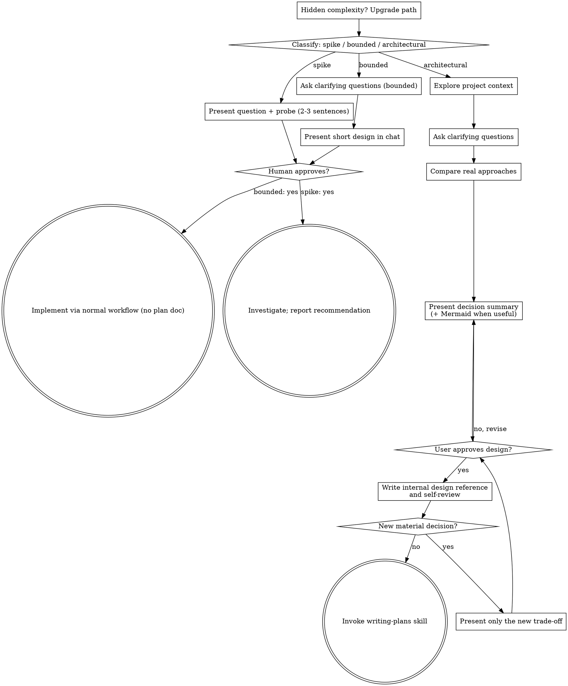

# Brainstorming Ideas Into Designs

Help turn ideas into fully formed designs and specs through natural collaborative dialogue.

Start by classifying how much process the request needs, then work
through your path: understand the context, refine the idea, present a
design, and get your human partner's approval.

## Establish Shared Understanding

The outcome of brainstorming is an understanding your human partner can
recognize and correct, grounded in what they want to accomplish.

1. **Discover intent.** Use the request and available context to identify
   the intended outcome, who it is for, and what success looks like. When
   that information is missing, ask one focused question about purpose or
   intended use before proposing features or an approach. Knowing the app
   genre does not tell you why your partner wants it. Gathering missing
   requirements does not ask them to authorize the task again.
2. **Write back your understanding.** Summarize the intended outcome,
   relevant constraints, and success criteria in a short note your partner
   can assess. Separate what they said from assumptions. Invite correction
   and incorporate their answer before treating this as the design brief.
3. **Carry intent into the design.** Preserve the agreed understanding in
   the selected path's design artifact: the written spec for architectural
   work, or the in-chat design/probe for bounded work and spikes. Check
   proposed features and technical choices against that understanding.

When the request already supplies the purpose and constraints, reflect
that understanding instead of asking the same questions again. Keep the
note concise; its accuracy and the opportunity to correct it matter.

<HARD-GATE>
Before taking any implementation action, including invoking an
implementation skill, writing product code, scaffolding, installing
product dependencies, or creating an external project, complete the
selected path's prerequisites:

- Spike: the human partner approves the question and probe.
- Bounded: the human partner approves the short in-chat design.
- Architectural: the human partner approves the consequential design choices
  presented in conversation. Record the approved design in a spec and prepare
  an implementation plan internally. If either artifact exposes a new decision
  that materially changes the agreed outcome, scope, risk, or cost, present
  only that decision and its trade-off in conversation and wait for approval.

Approval applies to the design and boundaries actually presented, not to a
new choice quietly introduced in a later artifact. When the user has already
requested implementation, approval of the conversational design authorizes
preparing internal artifacts and continuing to implementation within those
boundaries; neither artifact requires a second read-the-file approval gate.
Read-only project exploration is allowed before approval.
</HARD-GATE>

## Three Paths

Before your first question, classify the request and say the
classification out loud — "this looks bounded, so I'll present a short
design here rather than write a spec" — so your human partner can
override it:

- **Spike** — a feasibility question ("can we...", "is it possible...",
  "quick and dirty is fine") whose output is an answer, not code you
  keep. Present the question and what you'll try in 2-3 sentences, get
  a nod, then find out as cheaply as correctness allows. No design
  doc, no spec file. Report findings as a recommendation; anything you
  built stays labeled throwaway.
- **Bounded** — a well-scoped change to code that already exists in
  this repo: a new flag, a small endpoint, a one-file fix.
  Understanding the kind of app is not enough — bounded means the flow
  you are changing is already here to read. If there is no existing
  flow to change, the task is not bounded. Ask the clarifying
  questions that matter, present a short design IN CHAT (a few
  sentences to a few short paragraphs), and STOP. Implementation
  starts only after your human partner says yes to that design — a
  bounded task's approval is as hard a gate as an architectural
  one. No spec file, no implementation plan document.
- **Architectural** — new projects, new subsystems, changes that
  restructure how components fit together or alter interfaces others
  depend on. Discuss the consequential choices in chat, then keep the
  spec and plan as implementation references, not reading assignments.

When in doubt between two paths, take the heavier one. The ratchet is
one-way: hidden complexity discovered mid-task upgrades the path —
stop, say so, and step up. Nothing downgrades mid-task.

## Anti-Pattern: "Too Simple To Need Approval"

Every path ends with your human partner approving the required design
before implementation. A bounded change may need only two sentences in
chat. A new todo-list project is architectural and requires the written
spec and planning handoffs. Scale the artifact to the selected path;
complete that path's reviews before implementation.

## Red Flags

| Thought | Reality |
|---------|---------|
| "This is too simple to need a design" | Follow the selected path: a bounded change gets a short chat design; an architectural change gets the written spec and planning handoffs. |
| "I'll call it bounded and skip the spec" | Reaching for a label to skip work IS the doubt — take the heavier path. |
| "It's bounded and the design is obvious — I'll start while they read it" | The gate is the approval, not the design's length. Present, then stop until you hear yes. |
| "I understand this kind of app, so it's bounded" | Bounded measures the repo, not your familiarity. A new project has no existing flow — it is architectural. |
| "The spike works, so I'll keep the code" | A spike's output is an answer. Keeping the code is a new request — classify it. |
| "It grew, but I'm almost done — no need to re-classify" | Hidden complexity upgrades the path mid-task. Stop and say so. |
| "They approved the spike, so the follow-up change is approved too" | Each task gets its own classification and its own approval. |

## Checklist

Classify first, announce the path, then create a task for each item on
your path and complete them in order.

**Spike:**
1. **Explore project context** — enough to frame the probe
2. **Present question + probe plan** — 2-3 sentences
3. **Get approval** — a nod is enough
4. **Investigate** — as cheaply as correctness allows
5. **Report findings** — a recommendation; label anything built as throwaway

**Bounded:**
1. **Explore project context** — check files, docs, recent commits
2. **Ask clarifying questions** — one at a time, the ones that matter
3. **Present short design in chat** — approach, files touched, testing
4. **Get approval** — STOP and wait for an explicit yes; presenting the design and starting in the same breath is skipping the gate
5. **Implement** — proceed with the normal development workflow (TDD applies); no plan document

**Architectural:**
1. **Explore project context** — check files, docs, recent commits
2. **Ask clarifying questions** — one at a time, only for consequential uncertainty not resolved by code or context
3. **Compare approaches** — briefly state recommendation, main alternative and decisive trade-off; do not manufacture options
4. **Present design in conversation** — outcome, causal chain, key choices and risks; use `explain-with-diagrams` when relationships would be clearer as a Mermaid diagram; get approval of the proposed direction
5. **Write implementation reference** — save to `docs/superpowers/specs/YYYY-MM-DD-<topic>-design.md` and self-review for gaps; follow project documentation conventions
6. **Surface only new decisions** — if writing exposes a materially new choice, summarize the difference and wait; otherwise continue to writing-plans without asking the user to read the spec

## Process Flow

**Terminal states are path-bound.** Architectural: after conversational
approval, invoke writing-plans, not an implementation skill. Writing the
internal spec is not a new user review gate. Bounded: after approval,
implement directly with the normal development workflow; no plan document.
Spike: report a recommendation.

## The Process

The subsections below serve the bounded and architectural paths (a
spike stops at "present the probe, get a nod"). Sections from
**Exploring approaches** onward are architectural-path depth — for
bounded work, context plus a few questions plus a short in-chat design
is the whole process.

**Understanding the idea:**

- Check out the current project state first (files, nearby tests, docs, recent commits). Resolve questions the repository can answer before asking the user; reserve their attention for decisions only they can make
- Before asking detailed questions, assess scope: if the request describes multiple independent subsystems (e.g., "build a platform with chat, file storage, billing, and analytics"), flag this immediately. Don't spend questions refining details of a project that needs to be decomposed first.
- If the project is too large for a single spec, help the user decompose into sub-projects: what are the independent pieces, how do they relate, what order should they be built? Then brainstorm the first sub-project through the normal design flow. Each sub-project gets its own spec → plan → implementation cycle.
- For appropriately-scoped projects, ask questions one at a time to refine the idea
- Prefer multiple choice questions when possible, but open-ended is fine too
- Only one question per message - if a topic needs more exploration, break it into multiple questions
- Focus on understanding: purpose, constraints, success criteria

**Exploring approaches:**

- Lead with the recommended approach, its reason and the main alternative's cost; compare 2-3 approaches only when there is a real choice
- Keep the conversation about decisions the user can react to, not the complete spec
- YAGNI ruthlessly - remove unnecessary features from every approach and design

**Presenting the design:**

- Lead with the intended outcome and causal chain, then the decisive trade-offs, risk and verification approach in a few conversational sentences; ask for a reaction to this summary
- For complex architecture, lifecycle or dependencies, use `explain-with-diagrams` to show an accurate Mermaid relationship view rather than expanding prose. A straightforward choice needs no diagram
- Preserve architecture, components, data flow, errors and tests in the internal reference, not in a wall of chat text. Offer the file path as optional background, not as homework
- If the user corrects one decision, repair that decision locally; do not replay or rewrite the entire design conversation

**Design for isolation and clarity:**

- Break the system into smaller units that each have one clear purpose, communicate through well-defined interfaces, and can be understood and tested independently
- For each unit, you should be able to answer: what does it do, how do you use it, and what does it depend on?
- Can someone understand what a unit does without reading its internals? Can you change the internals without breaking consumers? If not, the boundaries need work.
- Smaller, well-bounded units are also easier for you to work with - you reason better about code you can hold in context at once, and your edits are more reliable when files are focused. When a file grows large, that's often a signal that it's doing too much.

**Working in existing codebases:**

- Explore the current structure before proposing changes. Follow existing patterns.
- Where existing code has problems that affect the work (e.g., a file that's grown too large, unclear boundaries, tangled responsibilities), include targeted improvements as part of the design - the way a good developer improves code they're working in.
- Don't propose unrelated refactoring. Stay focused on what serves the current goal.

## After the Design (architectural path)

**Documentation:**

- Write the approved design as an implementation reference to `docs/superpowers/specs/YYYY-MM-DD-<topic>-design.md` (user or project preferences override this path). A change to an existing project should describe the affected flow and the **added, modified or removed** behaviors, not respecify the whole codebase
- Lead the document with outcome, core mechanism and boundaries; put implementation details under those headings. Keep the design separate from a later step-by-step plan
- Commit according to the project's normal git conventions. Treat the document as internal working context, not a user-facing review artifact

**Spec Self-Review:**
After writing the spec document, look at it with fresh eyes:

1. **Placeholder scan:** Any "TBD", "TODO", incomplete sections, or vague requirements? Fix them.
2. **Internal consistency:** Do any sections contradict each other? Does the architecture match the feature descriptions?
3. **Scope check:** Is this focused enough for a single implementation plan, or does it need decomposition?
4. **Ambiguity check:** Could any requirement be interpreted two different ways? If so, pick one and make it explicit.

Fix any issues inline. No need to re-review — just fix and move on.

**Decision check:** If self-review finds a new choice that changes the approved
outcome, external behavior, scope, compatibility or risk, describe just that
choice and why it matters, then wait for the user's answer. A missing
implementation detail that can be decided within approved boundaries is not
a new approval gate; record the assumption in the reference and proceed.

**Implementation:** Invoke writing-plans next, then follow its handoff. Do not
use the saved spec as the main way of communicating the design.

## Visual Communication

Use `explain-with-diagrams` when a design relationship is difficult to check in
prose. A Mermaid diagram should explain the domain workflow or boundaries,
followed by a short trade-off summary. Do not generate a generic project
process diagram as a substitute for the actual design. Never auto-open a GUI
window or browser to present a design.
